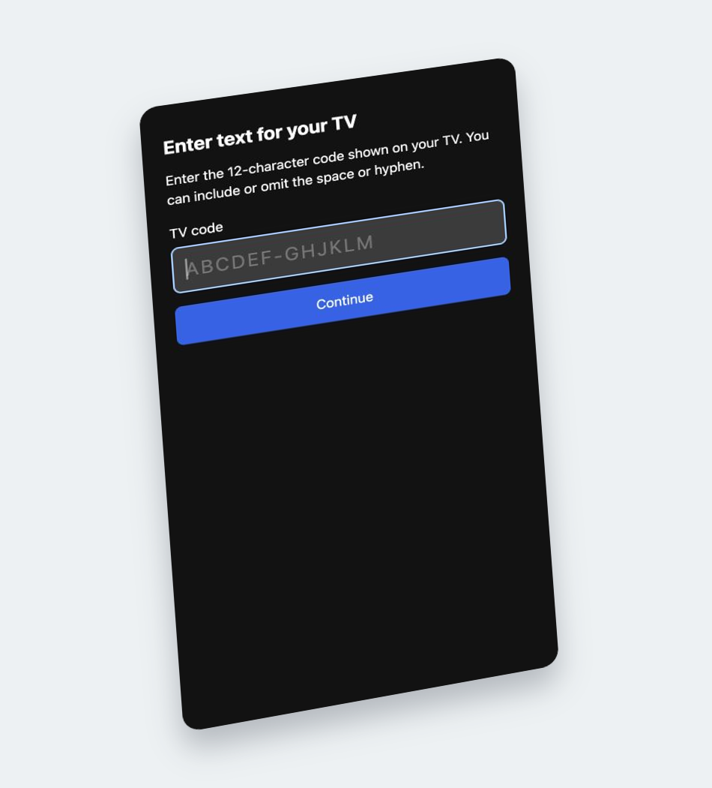

# ottplay-swop

*The actual mobile entry page, captured locally at 432 × 768 with an empty code.
No live TV session or account is shown. [Original and regeneration](docs/images/README.md).*

Cloudflare Worker for one-time session handoff: desktop creates a short code, mobile fills a form, desktop polls and burns the value after read.

<!-- ci-release-process:start -->
## Release process

See the [release strategy](RELEASING.md) for validation, nightly, beta, RC and stable promotion rules, and the [operator runbook](docs/release-workflow.md) for local commands.
<!-- ci-release-process:end -->

## Installation authorization

All TVs served by an authorized player installation can use remote text entry.
No per-TV allowlist is needed for this flow. The player uses its same-origin
`/swop` relay; that backend injects its own `Authorization: Bearer <token>`.
The installation token is never included in static assets, browser responses,
localStorage, QR codes, or input links.

Configure the Worker secret `INSTALLATION_CREDENTIALS_JSON` as a JSON array of
`{id, token, origins}` objects. Give each installation a different randomly
generated token of at least 256 bits (64 hexadecimal characters works) and a
list of exact origins, including scheme and any nondefault port. `originPolicy`
defaults to `require-origin`. Register each
local LAN/localhost origin separately. Tokens must match `[A-Za-z0-9_-]{32,256}`.
Use the Terraform Cloud sensitive variable `installation_credentials_json` or
`wrangler secret put INSTALLATION_CREDENTIALS_JSON`; never commit real values.

The relay must:

- Accept only session creation and polling, and always overwrite the upstream
  Authorization header with its own credential. Never relay `/admin`, arbitrary
  paths, redirects, or attacker-chosen upstream URLs.
- Validate the browser Origin (or Referer for same-origin GET/older browsers)
  against its actual scheme and host before adding the credential; reject
  cross-site requests and ambiguous/missing browser provenance.
- Forward that validated origin to SWOP. The Worker checks it against the
  credential's exact origin list and rejects `Sec-Fetch-Site: cross-site`.
- Keep credentials server-side and ensure errors and proxy configuration APIs
  never disclose them. Origin alone never grants authorization.

Managed relays such as here.now may enforce browser same-origin checks themselves
and strip Origin/Referer before forwarding. Enroll only that backend credential
with explicit `originPolicy: "trusted-proxy"`. It permits missing provenance
only for that credential; present foreign Origin/Referer and cross-site metadata
still fail. Never enable this on an unrestricted public relay. Responses to
requests without an Origin do not grant an Access-Control-Allow-Origin header.
Local installation credentials keep the default strict policy.

A copied player, Device ID, or session exchange does not grant an installation
credential. A captured session capability is limited to its original session,
installation, client, and original expiry. Public browser applications cannot
cryptographically attest where a user is running their own modified browser;
a determined attacker can relay public traffic through an authorized site.
Backend credentials plus browser origin checks prevent ordinary copied-site
use and direct unauthorized SWOP access, not an arbitrary non-browser relay.

### API flow

1. The player sends `POST /swop/session` with JSON `{caption, draft, clientId}`.
   `X-Swop-Client-Id` (or `X-Ottplay-Client-Id`) is also supported. IDs have
   8–128 characters from `[A-Za-z0-9._:-]`; they identify ownership, not permission.
2. The relay adds its installation credential. SWOP returns
   `{code, url, expiresIn, sessionToken, clientId, entryUrl, entryCode}`. The 256-bit `sessionToken` is the read
   capability: keep it in memory and never place it in the QR code or phone URL.
   Legacy TVs without secure random-number support may omit clientId during
   creation. The Worker issues a random owner ID; use the returned clientId
   for this session's polls. Missing or invalid poll IDs are rejected.
3. Show `entryUrl` and `entryCode` on the TV for manual browser entry, and encode
   the complete returned `url` in the QR/link. The QR URL contains a separate
   256-bit write capability (`?c=CODE&t=TOKEN`). Opening it renders the phone form;
   entering the six-character session ID alone cannot disclose the draft or submit a value.
   For manual entry, users open `entryUrl` and enter the 12-character code, shown
   as `ABCDEF-GHJKLM`. Lowercase, ASCII whitespace, and the optional hyphen are
   accepted; ambiguous `0`, `O`, `1`, and `I` are never generated. The root page
   is a simple code form, so users do not need a phone or a long URL.
4. The phone sends `POST /submit` with `{code, value, token}`. It needs neither
   the installation credential nor the Device ID. The supplied link is its
   temporary permission to enter text for that one session.
   The manual form instead sends `{code, value, entryCode}`. Only the hash of
   the full normalized manual code is stored. Eight incorrect manual attempts
   across form viewing and submission lock that manual code until session expiry;
   successful form viewing neither resets the counter nor extends expiry. The
   independent QR capability remains usable after manual lockout. Invalid,
   expired, and locked codes receive the same error. Manual entry does not grant
   read access or expose either QR or read token.
5. The player polls `POST /swop/val` with `{code, clientId, sessionToken}`.
   `GET /swop/val?c=CODE` with `X-Swop-Client-Id` and
   `X-Swop-Session-Token` remains supported. The relay adds its credential.
   SWOP returns `waiting`, `ready` with `value`, or `gone`.

Both capabilities are hashed before storage. Responses are `Cache-Control:
no-store`; phone pages use `Referrer-Policy: no-referrer`. Session allocation,
submission, and consumption use SQLite-backed Durable Object transactions.
Concurrent reads consume the value only once; expiry tombstones prevent replay
or premature reuse. Installation session expiry is never extended by submit.

The existing rate limiter permits 240 requests per minute. Authenticated
installation calls share a quota by installation and Cloudflare-observed source
IP, so attacker-selected Device IDs do not bypass the quota. Unauthenticated,
legacy, phone, and admin calls use the source-IP quota. The Worker checks
installation headers and quota before reading POST bodies; rejected streams are
cancelled without delaying the response. Valid installation credentials use the
same installation/IP quota even when the owner ID is missing or malformed.
Missing rate-limit or session-storage bindings fail closed. `GET /health` and OPTIONS are available
without authentication.

### Legacy compatibility and admin

Existing direct clients without an Authorization header still use KV entries
`allow:{clientId}`. Legacy sessions retain their existing wire format and phone
flow. Installation sessions cannot be read using the legacy allowlist, another
installation, another client, or a write token. A wrong installation credential
never falls back to a legacy allowlist entry.

`/admin/clients` remains protected exclusively by `ADMIN_TOKEN`: POST adds
`{clientId, note}`, GET lists entries, and DELETE with `?id=...` revokes an entry.
An installation credential cannot administer the service. Missing admin
configuration returns 503; an invalid admin credential returns 401.

The storage migration retains all allowlist entries and admin credentials.
Old pending KV sessions expire naturally; start a fresh text-entry session
following the cutover. See [atomic session migration](docs/atomic-session-migration.md).

## Setup

### VPortal relay

`POST /vportal/api` accepts the player envelope `{url, params}` and forwards only
`params` as JSON to an operator-approved portal API. `params.app` must be
`ott-play` and `params.key` must be a nonempty string. The player-host backend
must overwrite Authorization with its private installation Bearer credential
and enforce same-origin access, using the same enrollment and origin policy as
SWOP. This endpoint does not accept the legacy Device ID allowlist and does not
require a text-entry session or client ID.

Set Terraform's `vportal_endpoints` to the exact API URLs the installation needs;
it becomes the `VPORTAL_ENDPOINTS_JSON` binding. Its default empty list disables
the relay. URLs must use canonical HTTP(S), a DNS hostname and the default port,
without userinfo, query, fragment, percent encoding, or path normalization. There
are no built-in destinations. Choose only operator-trusted portal hosts; the
allowlist is an exact destination gate, not a DNS ownership or IP-pinning check.
HTTP remains available for existing portals; use HTTPS when the portal supports
it. Never include portal keys in endpoint configuration.

Requests are limited to 128 KiB, encoded params to 64 KiB, responses to 8 MiB,
and the upstream operation including response body to 25 seconds. The existing
rate limiter uses a separate VPortal installation/IP key, preserving SWOP's
quota. At most two relays buffer responses per Worker isolate; additional calls
receive 503 with `Retry-After: 5`. Redirects are refused. Only fixed JSON headers
and `User-Agent: OTT-play-FOSS/1.0` accompany the params; caller cookies and
Authorization never reach the portal. Upstream error bodies and transport
details are not returned or logged. Valid JSON success bodies are passed through
with `application/json`, `nosniff`, and no-store, including legacy PHP responses
that declare another MIME type. No relay response permits cross-origin CORS.
Relay failures include a fixed `code` (`upstream_http`, `transport`,
`response_limit`, `invalid_json`, or `timeout`) for operational diagnosis;
`upstream_http` also supplies the numeric `upstreamStatus`. No upstream URL,
body, credential, or exception message appears in this diagnostic response.

For a static player host, configure a same-origin backend proxy at
`/vportal/api` targeting this Worker's `/vportal/api`, with the installation
credential injected on the server. Do not expose that credential in browser
JavaScript, query parameters, or the proxy response.

### Local development

1. Copy example wrangler config to wrangler.toml; fill placeholders.
2. Install project dependencies.
3. Use package scripts for local development; production Worker updates go through Terraform (see Infrastructure).

wrangler.toml is gitignored and must never be committed with real credentials.

The npm overrides keep the Miniflare toolchain on patched `sharp 0.35.5` and
`undici 7.29.1` dependencies. Tests run directly against Miniflare and Vitest;
they do not need the separate Cloudflare Vitest worker-pool package.

Keep credentials out of tracked `.tf` and variable files. This module passes
Worker secret bindings through Terraform, so sensitive values can be retained
in state and saved plans even when CLI output redacts them. Restrict access to
those files and the remote workspace; see
[Terraform sensitive-data handling](https://developer.hashicorp.com/terraform/language/manage-sensitive-data).

## Infrastructure (Terraform Cloud)

Durable Cloudflare resources — Workers KV namespace **and** the Worker script — are managed with Terraform Cloud.

- **Organization:** `open-ott-play`
- **Workspace:** `ottplay-swop`, as configured in `terraform/versions.tf`
- **Working directory:** `terraform`
- **Execution mode:** Remote (CLI-driven runs upload local `terraform/`, including `terraform/build/worker.js`)
- **VCS:** optional; CLI-driven remote runs do not require a VCS connection
- **VCS trigger patterns** (when connected): `terraform/**/*`
- **Variables** (never commit real credentials; the provider uses Global API Key authentication):
  - `account` — Cloudflare Account ID
  - `email` — Cloudflare login email
  - `key` (sensitive) — Cloudflare Global API Key
  - `public_base_url` — bound to the Worker as `PUBLIC_BASE_URL` (default `https://swop.2560801.xyz`)
  - `session_ttl_seconds` — bound as `SESSION_TTL_SECONDS` (default `600`)
  - `vportal_endpoints` — exact allowed VPortal API URLs as a Terraform `list(string)`; default `[]` disables the relay
  - `installation_credentials_json` (sensitive, optional) — JSON installation registry stored only as a secret binding
  - `admin_token` (sensitive, optional) — when set, Terraform manages the `ADMIN_TOKEN` secret_text binding; when empty, `keep_bindings = ["secret_text"]` preserves the existing Wrangler secret
  - For remote runs, configure the variables in the selected HCP Terraform workspace
  - Local overrides only if you switch execution to local or use `terraform.tfvars` / `-var`

### Build the Worker artifact (required before plan/apply)

Terraform uploads `terraform/build/worker.js` via `cloudflare_workers_script`. For a Worker code deployment, rebuild the bundle into that path before plan/apply (see package script `build:terraform` and the matching helper in `scripts/`). The package `build` step produces `dist/index.js`, which must be copied to `terraform/build/worker.js` (gitignored; `terraform/build/.gitkeep` is kept). For an infrastructure-only import, retain the exact deployed artifact as described below.

Then from `terraform/`: `terraform init`, `terraform plan`, `terraform apply`.

**What Terraform owns:** KV namespace (`cloudflare_workers_kv_namespace.swop`) and Worker script (`cloudflare_workers_script.swop`) with KV, Durable Objects, rate limiter, plain text, and optional secret bindings.

**Existing custom domains (optional):** `custom_domain_hostname` defaults to `null`, so other installations do not adopt this project's hostname. To adopt a domain already routed to the configured production Worker, set this non-secret Terraform variable persistently in the deployment workspace. Terraform looks up that exact existing route and imports it with `prevent_destroy`; it does not provision a new hostname. Keep the variable set on subsequent runs to retain ownership.

For an import-only change, preserve the exact deployed configuration and `terraform/build/worker.js` artifact. Review a full plan showing one import, zero resource additions/updates/deletions, and a Worker `no-op` before applying. Rebuilding current application source is unnecessary for this ownership change. A missing or mismatched existing domain fails the plan.

**Wrangler still useful for:** local `dev` / `tail` and secret experiments. Prefer Terraform apply for production script updates.

**Credentials never in git.** Root and `terraform/` gitignores exclude wrangler.toml, tfvars, `.env*`, credential material, `terraform/build/worker.js`, and local Terraform state/plan files.

### Local development and state ownership

Use the local Wrangler development flow above for application experiments.
The checked-in `terraform/versions.tf` selects the `open-ott-play` organization's
`ottplay-swop` workspace. Configure your own workspace and Cloudflare resources
for a separate installation; do not assume access to that deployment.

Moving existing resources between remote and local state is a state migration,
not a prerequisite for local application development. Removing `.terraform` only discards local
initialization metadata; it does not transfer resource ownership. Starting a
fresh local state against existing resources can propose duplicate resources or
conflict with the remote workspace.

Before an intentional migration, stop concurrent writers, preserve a protected
state backup, and review the source and destination state together with the
resource owners. Verify the resulting plan before any apply and retain a tested
rollback path. Do not delete a local state file to switch back to remote
execution or apply the same resources from independent states. State backups and
saved plans may contain secrets and must stay outside Git.

This module requires Terraform **1.15.7 or later**, as declared in
[`terraform/versions.tf`](terraform/versions.tf).

## Scripts

- package script:dev -> wrangler-dev (local)
- package script:deploy -> wrangler-deploy (prefer Terraform apply for production)
- package script:tail -> wrangler-tail
- package script:cf-typegen -> wrangler-types
- package script:build:terraform -> helper that fills `terraform/build/worker.js`
- `scripts/build-worker-for-terraform.sh` — required before `terraform plan`/`apply`
- `scripts/render-wrangler.sh` — fill local `wrangler.toml` from terraform outputs for dev/tail (run from **repo root**)

## Project maintenance

See [contribution and test requirements](CONTRIBUTING.md), the
[security reporting policy](SECURITY.md), [security design](docs/security-design.md),
and the [OpenSSF evidence and remaining criteria](docs/openssf-evidence.md).

## RC fuzzing

Public release candidates run bounded, offline mutation campaigns against
installation authorization and wire validation. See the [fuzzing guide](docs/fuzzing.md)
for targets, synthetic credentials, budgets, diagnostics and reproduction.
Ordinary PRs and beta builds do not run mutation campaigns.

## Project practices

[Contribute](CONTRIBUTING.md) · [Governance](GOVERNANCE.md) ·
[Code of Conduct](CODE_OF_CONDUCT.md) · [Roadmap](ROADMAP.md) ·
[Quality and assessment scope](docs/quality.md)
